<!--
  Mohammed Abu Saada | GitHub Profile
  Visual direction: premium dark / warm gold / clean technical aesthetic.
-->


 

  


  

  


<h2></h2>

I'm an **Agentic AI Engineer** and **Computer Systems Engineering graduate (2026)** focused on building practical AI products, intelligent agents, and business automation systems.

I work across the full journey: understanding a problem, designing the workflow, integrating models and tools, building the product, and shipping it.

- **9+ client projects** across AI agents, chatbots, and workflow automation.
- Built and launched **Sahihly** and **AI Rank**.
- Delivering a **90-hour AI & Automation training program** at Areisto Academy.
- Focus areas: Agentic AI, multi-agent orchestration, RAG, voice AI, and API integrations.
- Full-stack development with React, Next.js, Node.js, TypeScript, and Python.

**Based in Gaza, Palestine · Open to remote opportunities and collaborations.**

<h2></h2>

<table>
<tr>
<td width="50%"><a href="https://sahihly.com"></a></td>
<td width="50%"><a href="https://airanktools.com"></a></td>
</tr>
<tr>
<td width="50%"></td>
<td width="50%"></td>
</tr>
<tr>
<td width="50%"></td>
<td width="50%"></td>
</tr>
</table>

<h2></h2>


<h2></h2>


 

 

### AI · Agents · Automation

### Frontend · Backend · Data

| Domain | Skills |
|---|---|
| **AI Engineering** | Agentic AI, AI Agents, Multi-Agent Systems, LLM Integration, Tool Calling, Prompt Engineering, RAG, Vector Databases, LangChain, OpenAI API, MCP, ElevenLabs |
| **Automation** | n8n, Webhooks, API Integration, Workflow Design, Google Calendar, Google Sheets, WhatsApp & Telegram Bots |
| **Backend & Data** | Python, Node.js, Express, REST APIs, Authentication, PostgreSQL, MongoDB, SQL |
| **Frontend** | React, Next.js 15, TypeScript, JavaScript, Tailwind CSS, Framer Motion, HTML, CSS |
| **Engineering** | Data Structures, Algorithms, Problem Solving, Git, GitHub, Chrome DevTools |

<h2></h2>

| Role | Organization | Period |
|---|---|---|
| **AI & Automation Trainer** | Areisto Academy | Sep 2026 – Nov 2026 |
| **Freelance AI Automation Engineer** | Independent & Aysel Agency | 2024 – Present |
| **Frontend Developer** | Tech From Palestine | Jul 2025 – Oct 2026 |
| **Full Stack Developer Intern (Node.js)** | Areisto Software | Sep 2025 – Nov 2025 |
| **B.Sc. Computer Systems Engineering** | Al-Azhar University, Gaza | 2022 – 2026 |

<h2></h2>

- Advanced RAG with Vector Databases and Retrievers — IBM / Coursera
- Vector Databases for RAG: An Introduction — IBM / Coursera
- Build RAG Applications: Get Started — IBM / Coursera
- Develop Generative AI Applications: Get Started — IBM / Coursera
- Prompt Engineering with the OpenAI API — DataCamp
- Building Marketing Workflows with n8n — DataCamp
- Introduction to AI Agents — DataCamp

<h2></h2>

  

  

<picture>
  <source media="(prefers-color-scheme: dark)" srcset="https://raw.githubusercontent.com/mohammed4122002/mohammed4122002/output/github-snake-dark.svg" />
  
</picture>

  

  

  

<h2></h2>

  

